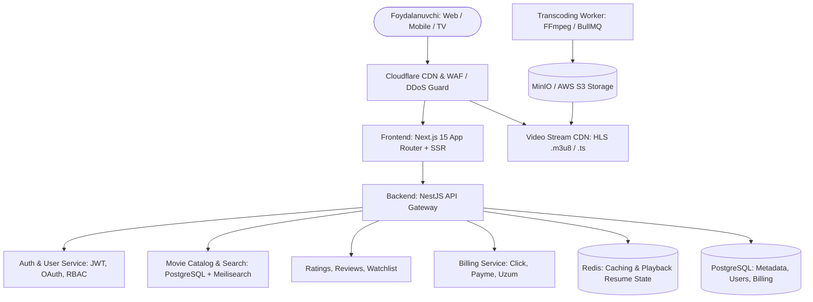
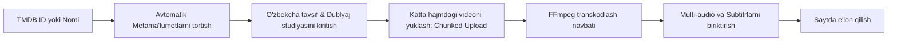

# 🎬 GLOBAL VA MILLIY KINO STRIMING PLATFORMASI — MASTER REJA
*(Netflix, Kinopoisk va IMDb darajasidagi raqobatbardosh tizim)*

---

## 📌 1. LOYIHA KONSEPSIYASI VA STRATEGIYASI

### 1.1. Missiya
O‘zbekiston va mintaqa foydalanuvchilari uchun xalqaro standartlarga (Netflix, Kinopoisk, Disney+) to‘liq javob beradigan, milliy va xorijiy kinolar, seriallar, animatsion filmlarni yuqori sifatda (4K/Full HD), professional o‘zbekcha dublyaj va subtitrlar bilan taqdim etuvchi zamonaviy striming ekotizimini yaratish.

### 1.2. Raqobatbardosh Ustunliklar (USP — Unique Selling Proposition)
1. **Lokalizatsiya va Dublyaj Tanlovi:** Bir nechta audio-yo‘lakcha (Professional o‘zbekcha, original, ruscha) va subtitrlar.
2. **Kuchsiz Internetda ham Qotmasdan Ishlash:** Adaptiv HLS striming texnologiyasi orqali har qanday internet tezligiga moslashish (Tas-IX va mahalliy CDN integratsiyasi).
3. **Mahalliy To‘lov Tizimlari:** Click, Payme, Uzum Bank orqali bir bosqichli qulay oylik obuna yoki xarid.
4. **Kino-Ensiklopediya (IMDb/Kinopoisk gibridi):** Faqat video ko‘rish emas, balki to‘liq filmografiya, aktyorlar profillari, foydalanuvchilar baholari, treylerlar va sharhlar bazasi.
5. **Cross-platforma:** Web (Desktop/Mobile), PWA, keyingi bosqichda Android, iOS va Smart TV (Android TV, Samsung Tizen, LG webOS).

---

## 🎨 2. UI/UX DIZAYN TIZIMI VA STRUKTURASI

### 2.1. Vizual Stilistika (Design Tokens)
* **Asosiy mavzu (Theme):** Chuqur kinemotografik qorong‘i fon:
  * Fon (Background): `#0B0E14` (Deep Night Black)
  * Kartalar va Bloklar (Surface): `#151A23` va `#1F2633`
  * Asosiy aksent (Accent Primary): `#E50914` (Cinema Red) yoki `#0066FF` (Electric Blue)
  * Qo‘shimcha aksent (Accent Secondary): `#FFB800` (Gold — Reyting va mukofotlar uchun)
  * Matnlar: Asosiy matn `#FFFFFF`, ikkilamchi matn `#94A3B8` (Muted Slate)
* **Tipografika:** Sarlavhalar va matnlar uchun zamonaviy `Inter`, `Montserrat` yoki `Plus Jakarta Sans`.
* **Vizual effektlar:** Shisha effekti (Glassmorphism / Backdrop Blur), kartalarni hover qilganda 3D kengayish (Smooth Scale-up), avtomatik ovozsiz treyler boshlanishi.

### 2.2. Sahifalar Arxitekturasi va Layoutlar

#### 1. Asosiy Sahifa (Home Page):
* **Hero Section (Bosh dinamik banner):**
  * Haftaning eng yirik premyerasi katta ekranda.
  * O fonda sifatli treyler avto-pley bo‘ladi (ovoz tugmasi bilan).
  * «Tomosha qilish», «Treyler», «Mening ro‘yxatimga qo‘shish» tugmalari.
* **«Davom ettirish» (Continue Watching) bloki:** Foydalanuvchi oxirgi marta qaysi film yoki serial qismida to‘xtagan bo‘lsa, foizi va davomiyligi bilan birinchi bo‘lib chiqadi.
* **Gorizontal Slayderlar (Netflix Rails):**
  * 🔴 *Top-10 bugun O‘zbekistonda eng ko‘p ko‘rilayotganlar* (katta raqamlar bilan).
  * 🍿 *Yangi premyeralar (2026)*.
  * 🇺🇿 *O‘zbek kino va seriallari*.
  * 🌟 *IMDb reytingi 8.0 dan yuqori durdonalar*.
  * 🎭 *Janrlar bo‘yicha tanlovlar (Jangari, Komediya, Fantastika, Tarixiy)*.

#### 2. Film / Serial Sahifasi (Media Detail Page):
* Katta fon posteri (Backdrop) va gradient qoplamasi.
* Film metama'lumotlari: Yili, davomiyligi, yosh chegarasi (16+, 18+), audio tillari, mavjud sifatlar (4K, HDR, 5.1 ovoz).
* Reyting bloki: Sayt foydalanuvchilari reytingi, IMDb va Kinopoisk integratsiyasi.
* **Seriallar uchun maxsus blok:**
  * Mavsumlar (Season 1, 2...) va qismlar (Episodes) ro‘yxati (har bir qism uchun kadr, davomiyligi va qisqa mazmuni).
* **Aktyorlar va ijodiy guruh:** Suratlar bilan gorizontal karusel.
* **O‘xshash filmlar (Recommedations):** Sun'iy intellekt yoki janr asosida tanlangan o‘xshash kartalar.
* **Sharhlar va Munozara:** Foydalanuvchilar taqrizlari, fikrlar va spoiler ogohlantirishli sharhlar.

#### 3. Kengaytirilgan Qidiruv va Filter Sahifasi:
* Tezkor qidiruv (Instant Search with Debounce): Harf kiritilishi bilan pastda tavsiyalar chiqadi.
* Filtrlar: Janr, yil oralig‘i, mamlakat, ovoz beruvchi studiya, reyting balandligi, saralash (yangi, mashhur, bahosi yuqori).

#### 4. Shaxsiy Kabinet (User Dashboard):
* Multi-profil (Oilaviy akkaunt: Kattalar, Bolalar profili).
* «Mening ro‘yxatim» (Watchlist) va «Ko‘rishlar tarixi».
* Obuna holati, to‘lovlar tarixi va qurilmalar boshqaruvi.

---

## ⚙️ 3. TIZIMNING DASTURIY TUZILISHI (TECH STACK)

Dunyo miqyosidagi raqobatga dosh berish uchun arxitektura **Microservices** yoki **Modular Monolith** tamoyilida bo‘lishi lozim:

### 3.1. Frontend Texnologiyalari:
* **Freymvork:** **Next.js (React 19)** App Router arxitekturasi bilan.
  * *Sabab:* Ajoyib SEO (qidiruv tizimlarida birinchi o‘rinlarda chiqish), tezkor sahifa almashish (SSR/SSG/ISR).
* **Til:** **TypeScript** (kodning xatosiz va masshtablanuvchan bo‘lishi uchun).
* **Styling:** **Tailwind CSS** + **Shadcn UI** (Radix Primitives).
* **Animatsiyalar:** **Framer Motion** (ravon karusellar, modal oynalar, hover animatsiyalar).
* **Video Player:** **Video.js** yoki **Plyr** + maxsus sozланган **Hls.js / Shaka Player** (Netflix darajasidagi sifat o‘zgartirgich, audio-treklar selektori).

### 3.2. Backend Texnologiyalari:
* **Asosiy API:** **Node.js (NestJS)** yoki **Go (Golang)**.
  * NestJS — arxitekturasi qat'iy, korporativ darajadagi modul tizimi, mikro-servislar bilan oson integratsiya.
  * Go — yuqori yuklamali videostrim so‘rovlari va hisob-kitoblar uchun ideal.
* **Ma'lumotlar Bazasi:**
  * **PostgreSQL:** Asosiy relyatsion ma'lumotlar (foydalanuvchilar, filmlar, qismlar, obunalar, to‘lovlar).
  * **Redis:** Kesh (Cache), sessiyalar, filmlar ko‘rilayotganda sekundma-sekund qayerga yetganini xotirada saqlash (Resume watching) va Rate limiting.
  * **Meilisearch:** Google/Netflix darajasidagi xatolarni to‘g‘rilovchi (typo-tolerance) tezkor qidiruv tizimi.

### 3.3. Video Infratuzilmasi va Transkodlash (Eng Muhim Qism):
Fayllarni to‘g‘ridan-to‘g‘ri `.mp4` formatida yuklash katta xato hisoblanadi (server band bo‘lib qotib qoladi).
* **Transkodlash jarayoni (FFmpeg Pipeline):**
  1. Admin panelga toza `.mp4` yoki `.mkv` video yuklanadi.
  2. Orqa fonda **BullMQ** navbati orqali **FFmpeg** ishga tushadi.
  3. Video har xil sifatlarga bo‘linadi:
     * `1080p` (Full HD) — yuqori tezlikdagi internet uchun
     * `720p` (HD) — mobil va o‘rtacha internet uchun
     * `480p` (SD) — kuchsiz internet uchun
     * `360p` — minimal sarf uchun
  4. Audio treklar ajratiladi (O‘zbekcha, Ruscha, Inglizcha) va alohida `.m3u8` fayllarga bog‘lanadi.
  5. Natija **HLS (HTTP Live Streaming)** protokoli asosida `.m3u8` master pleylist va `.ts` parchalarga bo‘linib **S3/MinIO** xotirasiga joylanadi.
* **CDN (Content Delivery Network):**
  * O‘zbekiston foydalanuvchilari uchun mahalliy provayderlar kesh serverlari (Tas-IX ichidagi tezlik uchun) va xalqaro foydalanuvchilar uchun Cloudflare Stream / AWS CloudFront.

### 3.4. Xavfsizlik va Kontentni Himoyalash (Anti-Piracy):
* **HLS AES-128 Encryption:** Videolarni har bir `.ts` qismi shifrlanadi, kalit esa faqat ruxsati bor va tizimga kirgan foydalanuvchiga beriladi (brauzer yuklab ololmaydi).
* **Dinamik Watermark (Foydalanuvchi belgisi):** Ekranning burchagida vaqti-vaqti bilan ko‘rinib-yo‘qoladigan foydalanuvchi ID raqami (ekranni yozib olib tarqatishning oldini oladi).
* **Tokenized Stream URLs:** Video havolalari faqat 2-3 soat amal qiladi, boshqa saytlarga havola berib qo‘yish (Hotlinking) bloklanadi.

---

## 🛠️ 4. ADMIN PANEL (BOSHQARUV PANELI) ARXITEKTURASI VA IMKONIYATLARI

Platformaning muvaffaqiyatli ishlashi va kontentni oson boshqarish uchun qulay, tezkor va ko‘p funksiyali **Admin Dashboard** rejalashtirilgan.

### 4.1. Admin Panel Texnologiyasi va Xavfsizligi
* **Xavfsiz kirish:** `/admin` maxsus manzili, 2FA (Google Authenticator orqali ikki bosqichli tasdiqlash), IP whitelist (faqat ruxsat berilgan ofis/shaxsiy IP orqali kirish imkoniyati).
* **Interfeys:** Next.js + Tailwind CSS + Shadcn UI (TanStack Table, Recharts analitika grafikalari).
* **Rollarga asoslangan boshqaruv (RBAC — Role-Based Access Control):**
  * `SuperAdmin` — Tizimning barcha qismlari, xodimlar huquqlari, to‘lovlar va sozlamalarni boshqaradi.
  * `Content Manager` — Yangi filmlar, seriallar, posterlar yuklaydi va tahrirlaydi.
  * `Moderator` — Foydalanuvchilar qoldirgan izohlar, taqrizlarni o‘qiydi, tekshiradi va javob yozadi.
  * `Support Agent` — Foydalanuvchilarning texnik muammolari va obuna shikoyatlarini ko‘rib chiqadi.

---

### 4.2. Kino va Seriallarni Qulay Joylash Moduli (Media CMS)

Kontent menejeri uchun bir necha soatlik ishni 2-3 daqiqaga qisqartiruvchi avtomatlashtirilgan jarayon:

#### A. 1-Tugma bilan Ma'lumotlarni To‘ldirish (TMDB Autocomplete):
* Admin qidiruv maydoniga film nomini yoki TMDB ID raqamini yozadi.
* Tizim soniya ichida quyidagilarni avtomatik to‘ldiradi:
  * Asl nomi, davomiyligi, chiqarilgan yili, mamlakatlar, yosh chegarasi.
  * Rejissyorlar va aktyorlar tarkibi (suratlari va qahramon ismlari bilan).
  * Yuqori sifatli vertikal posterlar va gorizontal fon rasmlari (Backdrops).
  * Rasmiy YouTube treyleri havolasi.
* **AI Tarjima integratsiyasi:** Film tavsifini bitta tugma bilan professional tarzda o‘zbek tiliga o‘girish (yoki qo‘lda tahrirlash).

#### B. Katta Hajmdagi Videolarni Yuklash (Resumable Chunked Upload):
* 10 GB dan 50 GB gacha bo‘lgan og‘ir videofayllarni uzilishlarsiz yuklash (Tus.io yoki S3 Multipart Upload). Internet uzilib qolsa ham qolgan foizidan davom etadi.
* **Jonli Transkodlash Monitoringi:**
  * Har bir video holati admin panelda jonli foiz bilan ko‘rinadi: *«Navbatda» ➔ «1080p transkodlanmoqda (68%)» ➔ «Pleylistlar yaratildi» ➔ «E'lon qilindi»*.

#### C. Seriallar va Fasllar (Seasons & Episodes) Ierarxiyasi:
* Serial boshqaruvi daraxtsimon qulay ko‘rinishda: `Serial ➔ Fasl (Season 1, 2) ➔ Qismlar (1, 2, 3...)`.
* Har bir qism uchun alohida sarlavha, qism rasmi, davomiyligi va videofaylini yuklash.
* **«Intro o‘tkazib yuborish» tayming sozlamasi (Skip Intro):** Admin har bir qism uchun introning boshlanish va tugash sekundini (masalan, `01:12` dan `02:35` gacha) kiritib qo‘yadi — pleerda avtomatik tugma chiqadi.

#### D. Ko‘p Tilli Audio va Subtitrlar Menejeri:
* Bitta filmga bir nechta audio-yo‘lakcha yuklash:
  * 🇺🇿 O‘zbekcha (Dublyaj studiyasi nomi: masalan, «Tarjima kinolar studio», «Milliy dublyaj»).
  * 🇷🇺 Ruscha (Dublyaj / Professional).
  * 🇬🇧 Original (Inglizcha).
* Subtitr fayllarini (`.vtt`, `.srt`) oson sudrab tashlash (Drag & Drop).

---

### 4.3. Izohlar, Taqrizlar va Muloqot Moderatsiyasi

Foydalanuvchilar qoldirgan har bir fikr-mulohazani nazorat qilish va ular bilan faol muloqot qilish tizimi:

* **Birlashgan Izohlar Paneli (Unified Comment Stream):**
  * Saytdagi barcha kinolarga yozilgan yangi izohlar xronologik tartibda bitta markazlashgan oynaga tushadi.
  * Qaysi foydalanuvchi qaysi filmga, qachon va qanday reyting bilan izoh qoldirgani ko‘rinib turadi.
* **Izohlar holati (Status):**
  * 🟢 *Tasdiqlangan (Approved)* — saytda ochiq ko‘rinadi.
  * 🟡 *Kutilmoqda (Pending Review)* — shubhali yoki yangi foydalanuvchilar izohi.
  * 🔴 *Spam / Qoidabuzarlik (Flagged)* — boshqa foydalanuvchilar tomonidan shikoyat tushgan izohlar.
* **Adminga Xos Imkoniyatlar:**
  * **Rasmiy Javob Berish (Admin Reply):** Admin yoki Moderator izoh tagiga javob yozganda uning ismida **«👑 Administrator»** yoki **«Qo‘llab-quvvatlash xizmati»** degan maxsus tasdiqlangan belgi chiqadi.
  * **Izohni Qadab Qo‘yish (Pin Comment):** Eng foydali taqrizni yoki muhim ogohlantirishni film sahifasida eng birinchi o‘ringa qadab qo‘yish.
  * **Spoiler Belgilash (Mark as Spoiler):** Agar foydalanuvchi filmning yakunini aytib qo‘ygan bo‘lsa, admin uni o‘chirib yubormasdan, «Spoiler» filtriga oladi (izoh xiralashadi, bosgandagina ochiladi).
  * **Avtomatik Haqorat Filtri (Profanity Filter):** Haqoratli yoki nojo‘ya so‘zlar yozilgan izohlar avtomatik bloklanadi va moderatorga ko‘rib chiqish uchun yuboriladi.

---

### 4.4. Foydalanuvchilar va Obunalar Boshqaruvi
* **Foydalanuvchilar Ro‘yxati:** Ismi, telefoni/emaili, ro‘yxatdan o‘tgan sanasi, oxirgi kirgan vaqti va IP manzili.
* **Obunalar Nazorati:** Kimda qaysi obuna turi (Standard, Premium) faol, qachon tugaydi, to‘lov qaysi tizim (Click, Payme, Uzum) orqali o‘tgan.
* **Tezkor Harakatlar:**
  * 1-bosish bilan foydalanuvchini bloklash (Ban / Unban) va bloklash sababini ko‘rsatish.
  * Obunani qo‘lda uzaytirish yoki bekor qilish (Support holatlari uchun).
  * Foydalanuvchining hisobidagi faol qurilmalar sessiyalarini tozalash.

---

### 4.5. Bosh Sahifa va Marketing Menejeri
* **Hero Banner Konfiguratori:** Bosh sahifaning eng yuqori qismidagi katta slayderda qaysi filmlar turishini erkin tanlash, drag-and-drop orqali o‘rnini almashtirish.
* **To‘plamlar Yaratish (Curated Collections):**
  * Masalan: *«Navro‘z bayrami munosabati bilan komediyalar»*, *«Oskar 2026 g‘oliblari»*, *«Koreys seriallari durdonalari»*.
* **Push-Bildirishnomalar Yuborish:** Yangi film yoki mashhur serialning yangi fasli chiqqanda barcha ro‘yxatdan o‘tgan foydalanuvchilarga sayt/brauzer orqali tezkor xabarnoma yuborish.

---

### 4.6. Moliya va Jonli Analitika Dashboardi
* **Moliyaviy hisobotlar:**
  * Kunlik, haftalik va oylik daromad grafigi (Click, Payme, Uzum bo‘yicha alohida).
  * Yangi obunachilar soni va obunani bekor qilganlar (Churn rate) statistikasi.
* **Kontent tahlili:**
  * Eng ko‘p tomosha qilingan Top-20 film va seriallar (soat hisobida).
  * Eng ko‘p qidirilgan, ammo bazada topilmagan so‘rovlar (bu adminlarga qaysi filmlarni tezroq yuklash kerakligini aytadi!).
* **Jonli Monitoring (Live Viewers):** Ayni daqiqada saytda necha kishi video ko‘rayotgani va serverlarning yuklanish darajasi (CPU, RAM, Bandwidth).

---

## 💳 5. MONETIZATSIYA VA BIZNES MODELLAR

Platforma dunyo tajribasidagi quyidagi 3 ta model uyg‘unligida ishlaydi:
1. **SVOD (Subscription Video on Demand — Oylik Obuna):**
   * *Standart obuna:* Barcha filmlar reklamasiz, Full HD formatda, 2 ta qurilmada ko‘rish imkoni.
   * *Premium obuna:* 4K Ultra HD + HDR, oilaviy 5 ta profil, 4 ta qurilmada bir vaqtda tomosha qilish.
2. **TVOD (Transactional / Pay-per-view — Premyeralarni ijaraga olish):**
   * Kinoteatrlardan endi chiqqan yangi super-premyeralar obunaga kirmaydi, 30 kun ichida yoki 48 soatlik ijaraga alohida to‘lov bilan ochiladi.
3. **AVOD (Advertising VOD — Bepul reklama bilan):**
   * Ayrim eski filmlar, milliy seriallar va treylerlar bepul ko‘rsatiladi, ammo video boshida va o‘rtasida qisqa reklama (15-30 soniya) qo‘yiladi.

---

## 📅 6. BOSQICHMA-BOSQICH AMALGA OSHIRISH REJASI (ROADMAP)

| Bosqich | Davomiyligi | Bajariladigan Vazifalar |
| :--- | :--- | :--- |
| **1-Bosqich: Arxitektura & UI/UX** | 1–2 hafta | Foydalanuvchi tajribasi (Figma dizayn), ma'lumotlar bazasi sxemasini (ERD) chizish, loyiha skeletini yaratish. |
| **2-Bosqich: Frontend Asosi** | 3–4 hafta | Next.js, Tailwind CSS, Hero banner, kino kartalari, slaydlar, qidiruv va filter interfeysini qurish. |
| **3-Bosqich: Backend & API** | 5–6 hafta | PostgreSQL + Prisma, NestJS API, autentifikatsiya (JWT/OAuth), kino katalogi CRUD, TMDB API integratsiyasi. |
| **4-Bosqich: Video Player & HLS** | 7–8 hafta | FFmpeg transkoder servisi, HLS pleer, bir nechta audio trek va subtitrlarni ulash, "Resume playing" funksiyasi. |
| **5-Bosqich: Profil & Ijtimoiy** | 9–10 hafta | Foydalanuvchi profili, sharhlar, 10 ballik baholash, sevimlilar (Watchlist) va tavsiya algoritmi. |
| **6-Bosqich: To‘lovlar & Admin** | 11–12 hafta | Click / Payme to‘lov integratsiyasi, to‘liq boshqaruv Admin paneli (filmlar yuklash, statistikalar, daromadlar). |
| **7-Bosqich: QA, SEO & Launch** | 13–14 hafta | Xavfsizlik testi, yuklama testi (Stress test), SEO optimallashtirish, Production serverga (Docker/K8s) chiqarish. |

---

## 📋 7. KINO BAZASI VA METAMA'LUMOTLARNI TO‘LDIRISH MANBALARI

* **TMDB API (The Movie Database):**
  * Dunyodagi barcha filmlar, posterlar, treylerlar, aktyorlar biografiyasini avtomatik tortib olish va o‘zbek tiliga tarjima qilish uchun eng qulay ochiq API.
* **Mahalliy Kontent:**
  * O‘zbek kino ijodkorlari, dublyaj studiyalari bilan hamkorlik shartnomalari orqali eksklyuziv milliy kontent joylash.

---

> 💡 **Xulosa:** Ushbu reja bo‘yicha yaratilgan platforma oddiy kino ko‘rish sayti bo‘lib qolmay, O‘zbekiston bozorida Netflix, Kinopoisk va IVI kabi gigantlar bilan erkin raqobatlasha oladigan professional raqamli mediaga aylanadi.
